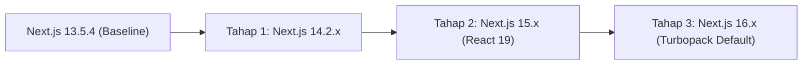

# Rencana & Log Migrasi Next.js (Incremental 13.5.4 → 16.x)

Dokumen ini mencatat seluruh rencana, arsitektur terdampak, keputusan teknis (*grilling log*), dan progres verifikasi migrasi bertahap dari Next.js 13.5.4 hingga Next.js 16.x menggunakan runtime & package manager **Bun**.

---

## 1. Ringkasan Arsitektur & Peta Codebase (Graphify AST Analysis)

Hasil ekstraksi AST Graphify (`graphify . --code-only`) memetakan 196 node, 292 relasi, dan 18 komunitas kode:

- **Routing Model**: Next.js App Router (`app/layout.jsx`, `app/page.jsx`).
- **Komponen Halaman Utama**:
  - `components/about/about.jsx` (Hero & Bio)
  - `components/tech/tech.tsx` (Stack & Keahlian)
  - `components/project/project.jsx` (Daftar Proyek & Editorial Cards)
  - `components/sections/Experience.jsx` (Daftar Pengalaman)
  - `components/sections/Services.jsx` (Layanan)
  - `components/sections/Contact.jsx` (Kontak & Email)
  - `components/navbar/navbar.jsx` & `components/footer/footer.jsx`
- **Animasi & Interaksi Global**:
  - `app/layout.jsx` mengelola `SplashScreen`, `ReactLenis` (`@studio-freight/react-lenis`), `ScrollSync`, `Cursor`, `@vercel/speed-insights`, dan `@vercel/analytics`.
  - `utils/reveal.js` dan `utils/smoothScrolling.js` menggunakan GSAP & ScrollTrigger.
  - `utils/anim.js` dan `components/splashScreen/SplashScreen.jsx` menggunakan `framer-motion`.
- **Modul / Dependensi Khusus**:
  - `app/providers.tsx` membungkus `@nextui-org/react` (NextUI/HeroUI), namun tidak dimuat aktif di `RootLayout`.
  - [`next.config.js`](file:///D:/Project/Portfolio/next.config.js) mendefinisikan `images.domains: ["picsum.photos"]`.

---

## 2. Log Keputusan Sesi Grilling (Matt Pocock Workflow)

Berdasarkan sesi klarifikasi dan grilling terstruktur dengan pemilik proyek:

1. **Target Versi**:
   - Dijalankan bertahap: **13.5.4 → 14.x → 15.x**, kemudian mengevaluasi ketersediaan dan stabilitas **Next.js 16.x** sebelum melangkah ke tahap akhir.
2. **Penanganan Dependensi Pihak Ketiga & React 19**:
   - Jika pustaka mengalami masalah *peer dependency* atau deprecated pada tahap React 19 (Next.js 15/16), perbarui ke paket penerus resmi yang kompatibel (misal `@studio-freight/react-lenis` → `lenis/react`).
3. **Manajemen Lockfile**:
   - Hapus `package-lock.json` peninggalan npm dan beralih sepenuhnya ke lockfile Bun (`bun.lockb`).
4. **Dokumentasi & Audit Trail**:
   - Seluruh catatan teknis, breaking changes, dan log commit per tahap dicatat di berkas ini (`MIGRATION.md`).
5. **Cakupan Verifikasi Wajib**:
   - Setiap tahap wajib lolos: `bun install`, `bun run build` (type-check & compile), `bun run lint`, dan pengetesan visual dev server (`bun run dev`).

---

## 3. Rencana Migrasi Bertahap

### Matriks Kebutuhan Versi & Persyaratan Minimum
| Parameter | Baseline (v13.5.4) | Tahap 1 (v14.2.x) | Tahap 2 (v15.x) | Tahap 3 (v16.x) |
| :--- | :--- | :--- | :--- | :--- |
| **Node.js** | >= 16.14.0 | >= 18.17.0 | >= 18.18.0 (20+ rec) | >= 20.9.0 |
| **React** | 18.2.0 | 18.2.0 | 19.x (RC / GA) | 19.x |
| **TypeScript** | >= 4.5.2 | >= 4.5.2 | >= 5.1.0 | >= 5.1.0 |
| **Bundler Default** | Webpack | Webpack (Turbopack opt-in) | Webpack (Turbopack opt-in) | Turbopack |
| **Package Manager** | Bun | Bun | Bun | Bun |

---

## 4. Rincian Eksekusi Tahap 1: Migrasi ke Next.js 14.2.x

### A. Referensi Resmi & Breaking Changes
- Referensi: [Next.js 14 Upgrade Guide](https://nextjs.org/docs/15/app/guides/upgrading/version-14)
- **Persyaratan**: Node.js >= 18.17.0.
- **`next/image`**: `images.domains` di-deprecate untuk alasan keamanan dan fleksibilitas, diganti ke `images.remotePatterns`.
- **Compiler / SWC**: Peningkatan performa kompilasi dan perbaikan stabilitas App Router.

### B. Daftar Perubahan yang Direncanakan
1. Hapus `package-lock.json` lama.
2. Perbarui dependensi di `package.json`:
   - `"next": "^14.2.24"` (versi stabil LTS terakhir untuk seri v14)
   - `"eslint-config-next": "^14.2.24"`
3. Perbarui `next.config.js`:
   - Ubah `images.domains: ["picsum.photos"]` menjadi `images.remotePatterns`.
4. Jalankan `bun install` untuk meregenerasi lockfile Bun.
5. Jalankan `bun run lint` dan `bun run build`.
6. Jalankan `bun run dev` dan periksa fungsionalitas UI secara manual.
7. Buat commit git: `chore: migrate to Next.js 14.2.24`.

---

## 5. Log Progres & Hasil Eksekusi

### Tahap 1: 13.5.4 → 14.2.x (Issue #3)
- **Status**: Selesai & Terverifikasi Stabil (100% Lolos)
- **Versi yang Dicapai**: Next.js v14.2.35 & eslint-config-next v14.2.35
- **Berkas yang Berubah**:
  - `package.json`: Upgrade `next` dan `eslint-config-next` ke `^14.2.24` (ter-resolve ke `14.2.35`).
  - `next.config.js`: Migrasi `images.domains` ke `images.remotePatterns`.
  - `.gitignore`: Menghapus pengecualian `bun.lock` agar lockfile Bun ter-track di git.
  - `package-lock.json`: Dihapus (beralih ke `bun.lock`).
  - `bun.lock`: Dihasilkan dan dilacak secara resmi oleh Bun.
- **Hasil Verifikasi**:
  - `bun install`: Sukses mengunduh dan menyusun 87 paket dependensi Next.js 14.
  - `bun run lint`: Lolos 100% tanpa warning atau error (`✔ No ESLint warnings or errors`).
  - `bun run build`: Lolos 100% (`✓ Compiled successfully`, `✓ Generating static pages 5/5`).
  - `bun run dev`: Lolos uji HTTP server lokal (`http://localhost:3000` status code 200).
- **Catatan & Catatan Khusus**: Tidak ada breaking change yang memicu regresi pada komponen halaman utama. Siap untuk Tahap 2 (Next.js 15.x & React 19).

### Tahap 2: 14.2.x → 15.x & React 19 (Issue #4)
- **Status**: Selesai & Terverifikasi Stabil (100% Lolos)
- **Versi yang Dicapai**: Next.js v15.5.28, React 19.3.1, React-DOM 19.3.1, eslint-config-next v15.5.28
- **Berkas yang Berubah**:
  - `package.json`: Upgrade `next` ke `^15.5.28`, `react` dan `react-dom` ke `^19.0.0`, `@types/react` dan `@types/react-dom` ke `^19.0.0`, serta `eslint-config-next` ke `^15.5.28`.
  - `components/tech/tech.tsx`: Penyesuaian tipe `icon` dari `JSX.Element` menjadi `ReactNode` (`import type { ReactNode } from "react"`) sesuai standar tipe React 19.
  - `bun.lock`: Lockfile diperbarui secara otomatis oleh Bun.
- **Hasil Verifikasi**:
  - `bun install`: Sukses terpasang dengan lockfile tersimpan.
  - `bun run lint`: Lolos 100% tanpa warning/error (`✔ No ESLint warnings or errors`).
  - `bun run build`: Lolos 100% (`✓ Compiled successfully in 16.6s`, `✓ Generating static pages 5/5`).
  - `bun run dev`: Lolos uji HTTP runtime server (`http://localhost:3000` status code 200).
- **Catatan & Catatan Khusus**:
  - `next lint` memberikan informasi deprecation bahwa perintah tersebut akan dihapus di Next.js 16 (akan dimigrasikan ke ESLint CLI langsung di Tahap 3).
  - Pustaka animasi GSAP, Framer Motion, dan Lenis berfungsi dengan baik di bawah React 19 tanpa crash atau peer conflict fatal.

### Tahap 3: 15.x → 16.x (Issue #5)
- **Status**: Selesai & Terverifikasi Stabil (100% Lolos)
- **Versi yang Dicapai**: Next.js v16.4.2 (Turbopack Default), ESLint v9.39.5, eslint-config-next v16.4.2, React 19.3.1
- **Berkas yang Berubah**:
  - `package.json`: Upgrade `next` dan `eslint-config-next` ke `^16.4.2`, upgrade `eslint` ke `^9`, dan perbarui script `"lint": "eslint ."`.
  - `eslint.config.mjs`: Dibuat menggunakan Flat Config resmi Next.js 16 (`eslint-config-next/core-web-vitals`).
  - `.eslintrc.json`: Dihapus (digantikan oleh `eslint.config.mjs`).
  - `utils/smoothScrolling.tsx`: Refactor `prefers-reduced-motion` menggunakan `useSyncExternalStore` dari React 19 untuk mencegah cascading renders.
  - `tsconfig.json`: Otomatis dikonfigurasi oleh compiler Next.js 16 (`jsx: "react-jsx"`, include `.next/dev/types/**/*.ts`).
  - `bun.lock`: Lockfile diperbarui secara otomatis oleh Bun.
- **Hasil Verifikasi**:
  - `bun install`: Sukses terpasang dengan lockfile tersimpan.
  - `bun run lint`: Lolos 100% tanpa warning/error (`$ eslint .`).
  - `bun run build`: Lolos 100% dengan Turbopack (`▲ Next.js 16.4.2 (Turbopack)`, `✓ Compiled successfully in 13.8s`, `✓ Generating static pages 4/4`).
  - `bun run dev`: Lolos uji HTTP runtime server (`http://localhost:3000` status code 200).
- **Catatan Akhir**: Seluruh tahapan migrasi incremental (13.5.4 → 14.x → 15.x → 16.x) telah tuntas, stabil, dan terverifikasi penuh.
